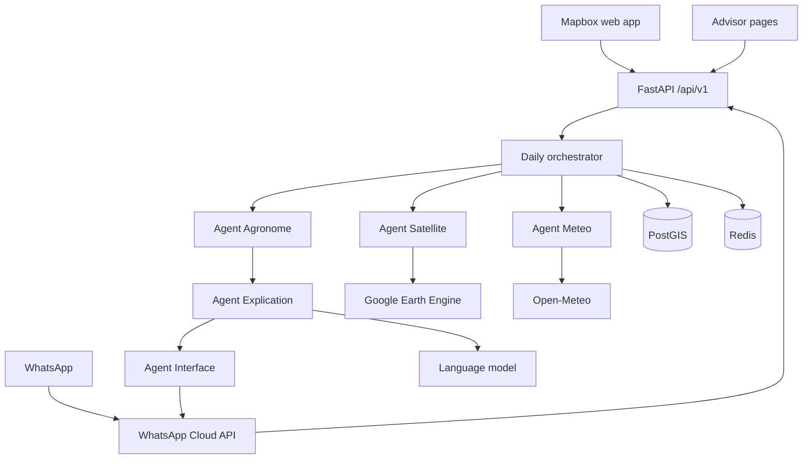
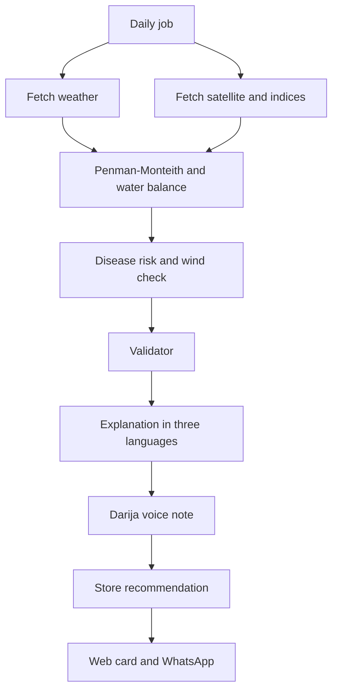
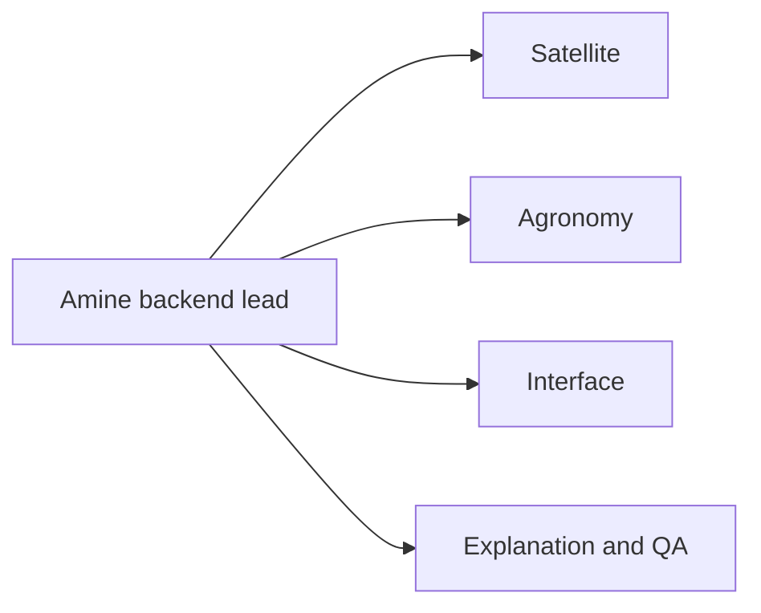

# Qatra — start report

Module M352, Advanced AI Engineering.  
Owner and backend lead: Mohammed Amine El Atrach.  
Team size: 5.  
Product name: **Qatra**.

This is the document the five of you build from. It describes the full product: the farmer site, WhatsApp, the advisor view, the water-balance engine, satellite, spray window, and explanations. What you later put on the defense slides can be chosen from this same system.

## 1. What Qatra is

Qatra is a precision-agriculture decision platform for citrus plots in Morocco.

A farmer draws a plot. Each day the system produces three outputs for that plot:

1. **Irrigation.** How much water the crop still needs, from a water-balance calculation.
2. **Canopy.** A Sentinel-2 reading (NDVI and NDWI), with the image date and a quality flag. If clouds hide the plot, a Sentinel-1 scene is recorded and confidence goes down.
3. **Spray window.** A weather-based disease-risk alert, a spray volume from the plot area, and a block when the wind is too strong.

The farmer reads this on a phone website and on WhatsApp, as text and as a Darija voice note. An advisor sees the same plots on a dashboard: vigor, who to visit, and the season’s water total.

The language model explains numbers that code has already computed. It writes Darija, French, and Arabic. It does not invent the dose, the index, or the spray rate.

## 2. What we take from the 9atra note

The friend’s breakdown is the engineering skeleton. These pieces enter Qatra as specified:

- JWT registration and login, roles, and rate limiting on public auth routes.
- PostgreSQL with PostGIS for plot polygons and area.
- Google Earth Engine for Sentinel-2, NDVI, NDWI, cloud masking, a PNG vigor overlay, and a daily imagery job.
- Sentinel-1 when the optical scene is too cloudy.
- Open-Meteo for temperature, humidity, wind, rain, and radiation.
- FAO-56 Penman-Monteith for reference evapotranspiration (ET0).
- A spray safety rule: wind above 15 km/h blocks the spray alert.
- Mapbox drawing, WhatsApp (Cloud API), Darija text-to-speech.
- Docker Compose (API, PostGIS, Redis), GitHub Actions, then Prometheus and Grafana once the daily test is green.
- The backend file layout in section 10.

Three decisions stay with Qatra, because they are what the course and the agronomy both require:

- **One website, not a second mobile codebase.** Mapbox runs in the phone browser. WhatsApp is the phone channel. A Flutter or React Native app would split the interface person across two products during the six weeks. A store app can follow after the defense.
- **The explanation agent stays a full seat.** The friend’s fifth seat was only DevOps. This module is an AI course, so that seat owns the language model, the FAO and INRA documents, Ask Qatra, and the tests. Amine owns Docker. The explanation seat owns the GitHub Actions test.
- **Disease names for citrus come from an agronomist.** Mildiou and oïdium are vine and vegetable diseases. Berkane citrus is a different crop. The spray-window mechanism stays: risk from temperature, humidity, and rain, volume from plot area, block when wind exceeds 15 km/h. Until an agronomist names the citrus disease, the alert label is `fungal_risk`, and the factors that raised it are stored beside it.

## 3. Users

**Farmer.** Registers, draws a plot, enters the citrus stage, irrigation method, last watering, and an optional spray product. Reads today’s card. Asks a question on the site or on WhatsApp. Receives a message when the instruction changes, if they opted in.

**Advisor.** A cooperative or ORMVA adviser follows many plots: a vigor map, a visit list, and a season water total.

## 4. Architecture



One FastAPI service. Redis queues the daily job. PostgreSQL with PostGIS stores farmers, polygons, weather, indices, and recommendations.

External systems:

- Google Earth Engine for Sentinel-2 and Sentinel-1. If approval is late, the satellite client can read one downloaded scene, and the live path says the image is missing.
- Open-Meteo for weather. No key for the basic forecast.
- WhatsApp Cloud API for messages in and out. Twilio is the backup if Meta business verification is slow.
- One chat API, called only from the explanation module.
- One speech API for the Darija voice note. The text is always sent with the audio.

The page and WhatsApp both talk to the API. Neither one invents a dose.

## 5. What each agent does

**Agent Satellite.** Fetches Sentinel-2 for the polygon, masks clouds, computes NDVI and NDWI, and writes the scene date plus the valid-pixel share. When valid pixels are under 70 percent, it fetches a Sentinel-1 scene, sets `radar_fallback` to true, and does not invent an optical index. Radar is not NDVI. It renders a PNG vigor overlay for that plot. A daily worker refreshes active plots.

**Agent Météo.** Pulls temperature, humidity, wind, rain, and solar radiation from Open-Meteo, with timestamps.

**Agent Agronome.** Computes ET0 with the FAO-56 Penman-Monteith equation from those weather inputs. Open-Meteo’s own ET0 is stored beside it as a check. Crop water use is:

`ETc = Kc × ET0`

The root-zone balance then applies useful rain, water already given, and drip or surface efficiency. The same agent raises `fungal_risk` from temperature, humidity, and rain, computes a spray volume from plot area and the configured rate per 100 L, and blocks that spray when wind is above 15 km/h. The rule and the factors are stored with the alert.

**Validator.** Sits in front of anything the farmer can see. `show_dose` requires a known stage, a known irrigation method, ET0 newer than 48 hours, and a satellite scene no older than 10 days. Otherwise the status is `needs_check`. Spray text is withheld when the wind rule fails. Owner: Amine.

**Agent Explication.** Writes Darija, French, and Arabic from the validated JSON and a small FAO and INRA folder. Ask Qatra on the web and from WhatsApp uses that same JSON. Every number in the text already exists in the result. If the model is down, a template fills the three languages from the JSON fields.

**Agent Interface.** Sends the text and, when speech synthesis returns audio, a Darija voice note.

## 6. Daily workflow



1. The worker loads each active plot.
2. Weather and satellite write their observations.
3. Agronomy computes ET0, ETc, the deficit, the gross irrigation, the risk alert, and the spray decision.
4. The validator sets `show_dose` or `needs_check`, and allows or blocks the spray.
5. Explication writes the three texts. Interface adds the voice note.
6. The row is stored. The web card updates. WhatsApp sends when the instruction changed and the farmer opted in. An inbound WhatsApp question uses the same Ask Qatra path.

On demand, `POST /plots/{id}/recommendation` runs the same pipeline for one plot so the demo does not wait for midnight.

### Water balance

`ETc = Kc × ET0`

ETc and ET0 are millimetres per day. Kc comes from a citrus table in code. Each value has a source comment. `docs/assumptions.md` records the table, the effective-rain fraction, the drip and surface efficiency, the 10-day satellite rule, and the 15 km/h wind rule.

Root-zone update:

- Add irrigation already recorded.
- Add effective rain, a fraction of forecast rain. The whole forecast is not subtracted.
- Subtract ETc.
- Convert the net deficit to a gross amount with the efficiency of drip or surface irrigation.

Sample day, locked by a test: ET0 = 4.2 mm, Kc = 0.75, ETc = 3.15 mm.

Tests:

- That sample day equals 3.15 mm.
- The same inputs replay to the same output.
- Missing NDVI forces `needs_check`.
- A scene older than 10 days forces `needs_check`.
- Wind at 16 km/h sets `spray_blocked` to true.
- Units stay in millimetres. Wind stays in km/h.

A stress score sits beside the dose. Version one computes it from the NDVI change, the deficit, and the growth stage, and lists those factors in `reasons`.

### Farmer path, same pipeline

1. The farmer draws a polygon in Morocco and enters citrus, drip or surface, growth stage, last irrigation date, and a phone number if they want WhatsApp.
2. The orchestrator loads the profile.
3. Weather stores ET0 inputs, past rain, and forecast rain, with the request time.
4. Satellite stores NDVI, NDWI, scene date, and valid-pixel percent, or a missing flag with a reason.
5. The engine computes the balance and the spray decision.
6. The validator returns the status.
7. The explanation module writes Darija, French, and Arabic.
8. The farmer sees the card and can ask a question. The advisor map updates from the stored row.

Example when data are weak:

> Besoin à vérifier. La météo du jour est disponible. La dernière image satellite est trop ancienne. La dose précise n’est pas affichée tant que l’humidité du sol n’est pas confirmée.

## 7. Shared contract

Amine publishes `docs/contract.json` on day 2. Field names change only with his approval. Data, Agronomy, Interface, and Explanation all code against this file.

```json
{
  "plot_id": "MA-001",
  "crop": "citrus",
  "stage": "fruit_growth",
  "area_ha": 1.2,
  "irrigation_method": "drip",
  "phone_opt_in": true,
  "date": "2026-10-15",
  "et0_mm_day": 4.2,
  "et0_open_meteo_mm_day": 4.1,
  "et0_source": "penman_monteith",
  "kc": 0.75,
  "etc_mm": 3.15,
  "rain_forecast_mm": 3.0,
  "effective_rain_mm": 1.5,
  "deficit_mm": 4.0,
  "gross_irrigation_mm": 4.7,
  "ndvi": 0.68,
  "ndwi": 0.2,
  "ndvi_observed_at": "2026-10-11",
  "valid_pixel_pct": 86,
  "radar_fallback": false,
  "wind_kmh": 9,
  "spray_blocked": false,
  "spray_volume_l": 240,
  "disease_risk": "low",
  "status": "show_dose",
  "reasons": ["fruit_growth", "rain_reduces_need"],
  "engine_version": "0.1.0",
  "text_fr": "",
  "text_ary": "",
  "text_ar": ""
}
```

`status` is `show_dose` or `needs_check`. `ndvi` is null when there is no usable optical scene. Every number in `text_fr`, `text_ary`, and `text_ar` must already exist in the object.

## 8. API and stored data

All routes live under `/api/v1`.

- `POST /auth/register` and `POST /auth/login` issue a JWT.
- `POST /plots` and `GET /plots` use GeoJSON polygons. PostGIS stores the geometry and the area.
- `POST /plots/{id}/recommendation` runs the pipeline and stores one row.
- `GET /plots/{id}/recommendations` returns history.
- `POST /plots/{id}/ask` answers from the latest row.
- `GET /advisor/plots` lists linked plots for the advisor role: status, stage, deficit, satellite age, season total.
- `POST /whatsapp/webhook` receives inbound WhatsApp events and routes them to Ask Qatra.

Farmers read their own plots. Advisors read plots linked to them. Public auth routes are rate-limited.

Tables:

| Table | What it stores |
| --- | --- |
| `farmers` | Account, role, phone, WhatsApp opt-in |
| `plots` | Polygon, area, crop, stage, irrigation method, advisor link |
| `weather_observations` | Open-Meteo inputs, computed ET0, source, time |
| `satellite_observations` | NDVI, NDWI, scene date, valid-pixel share, radar flag, overlay path |
| `irrigation_events` | Dates and known volumes |
| `recommendations` | The contract JSON, engine version, input timestamps |
| `messages` | Recommendation id, language, text, audio path, send time |

A recommendation stores the engine version and the time of each input so it can be replayed.

## 9. Screens and WhatsApp

Farmer site:

- Map of Morocco and the farmer’s plots.
- Plot form: crop, stage, irrigation method, last watering, phone opt-in.
- Result card: status, reasons, ETc, forecast time, image time, spray decision, three languages.
- Vigor PNG on the card.
- Ask Qatra.

Advisor site:

- Map of followed plots colored by status.
- Visit list: sensitive stage first (flowering, fruit growth), then highest deficit, with the satellite age.
- Season balance: rain, water advised, estimated crop need.

WhatsApp:

- Opt-in on the form.
- Outbound text is the validated explanation when the instruction changes.
- A Darija voice note is attached when synthesis returns audio. The text is always included.
- Inbound text is answered by Ask Qatra for that phone’s plot.

## 10. Repository

```text
qatra/
  docker-compose.yml
  .env.example
  Makefile
  README.md
  docs/contract.json
  docs/assumptions.md
  docs/QATRA-REPORT.md
  .github/workflows/ci.yml
  backend/
    Dockerfile
    alembic/
    app/main.py
    app/core/config.py
    app/core/database.py
    app/core/security.py
    app/api/v1/auth.py
    app/api/v1/plots.py
    app/api/v1/recommendations.py
    app/api/v1/whatsapp.py
    app/domain/models/
    app/services/satellite_service.py
    app/services/weather_service.py
    app/services/agronomy_service.py
    app/services/orchestrator.py
    app/services/validator.py
    app/services/explain.py
    app/services/notification.py
    tests/test_engine.py
    tests/test_validator.py
  web/
```

`docker-compose.yml` runs the API, PostGIS, and Redis. `.env.example` lists the database URL, the Earth Engine credentials, the Mapbox token, the model key, the speech key, and the WhatsApp token. No real secrets go in git.

The web app is Next.js with Mapbox GL for drawing and for the vigor overlay.

`Makefile` shortcuts: `make up`, `make test`, `make migrate`.

## 11. Roles



**Amine — owner and backend lead.** JWT and registration, PostGIS and migrations, Farmer, Plot, and Recommendation models, the REST API, roles, rate limiting, the orchestrator, the validator, and Docker Compose. He merges to main. He is the only person who renames a field. He keeps plot `MA-001`, talks to the agronomist, and presents.

**Satellite.** Earth Engine, NDVI and NDWI, cloud masking, Sentinel-1 fallback, PNG overlays, and the daily imagery fetch. Missing data stay null.

**Agronomy.** Open-Meteo, Penman-Monteith ET0, ETc and the root-zone balance, disease-risk rules, spray volume per plot, the 15 km/h wind block, and the engine tests.

**Interface.** Mapbox drawing, the farmer dashboard, the advisor pages, French, Darija, and Arabic in the UI, the WhatsApp webhook, and Darija text-to-speech.

**Explanation and QA.** The explanation prompt, the FAO and INRA folder, Ask Qatra, the offline template, the integration test of the daily workflow, and the GitHub Actions workflow. Prometheus and Grafana come after that test is green.

### Working rules

- One repository. One branch per person. Amine merges.
- The JSON contract is published on day 2. Nobody invents a private format.
- A recommendation stores the engine version and the time of each input.
- Week 1 is the only week seats can move.
- Monday: 30 minutes. Amine sets the week’s goal.
- Friday: each person demos on plot `MA-001`.
- A blocker older than one day is reported the same day.

The team demo is done when one citrus plot in Morocco can be drawn on a phone, with live weather, a satellite date or an honest missing image, a dose or `needs_check`, a spray decision, an explanation in French and Darija, that same plot on the advisor map, and a WhatsApp message to one test phone.

## 12. Six weeks

**Week 1 — contract.** Amine creates the repo, Compose with PostGIS and Redis, the sample plot, and `docs/contract.json`. Satellite reads one Earth Engine scene for that coordinate, or records why access is still pending. Agronomy returns ET0 from a fixed weather sample and passes ETc = 3.15. Interface shows a Mapbox map of Morocco. Explanation returns French and Darija for the fake JSON, with no extra numbers.

**Week 2 — accounts and live inputs.** Amine ships register, login, and plot create with a polygon. Agronomy stores Open-Meteo weather and the Penman-Monteith result in the contract fields. Satellite writes NDVI, NDWI, date, and valid-pixel share. Interface draws a polygon and posts it. Explanation explains a real agronomy JSON in three languages.

**Week 3 — one plot end to end.** Amine runs weather, satellite, agronomy, and the validator on `MA-001`. Validator cases: missing image, image older than 10 days, wind at 16 km/h. Interface shows the card with forecast time and image time as two facts. Satellite adds the PNG overlay.

**Week 4 — farmer product.** The farmer path works from the map to the card. Agronomy adds `fungal_risk` and the spray volume from area. Explanation ships Ask Qatra. Interface sends one WhatsApp text to a test number. Satellite survives a failed Earth Engine call without crashing the API.

**Week 5 — advisor and WhatsApp.** Advisor map, visit list, and season total. Daily worker over the demo plots. Darija voice note attached to the WhatsApp message. Sentinel-1 path when the optical scene is too cloudy. Inbound WhatsApp question answered by Ask Qatra.

**Week 6 — defense.** Roles enforced so farmers see only their plots. Integration test of the daily workflow in GitHub Actions. Prometheus and Grafana on the API and the worker. Full demo: a dose, a `needs_check`, a blocked spray, the advisor page, and WhatsApp text plus voice. Each member explains their module in two minutes. The spoken limit of the system: the result is a decision aid, and the farmer still checks the soil before changing a real irrigation turn.

If Earth Engine access is still closed in week 5, the daily job still runs on weather and the crop profile, the card says the image is missing, and the satellite function is shown on one downloaded scene.

## 13. Done

- Compose starts the API, PostGIS, and Redis from the README.
- A farmer can register, draw a citrus plot, and open a recommendation.
- Engine and validator tests pass: 3.15 mm, replay, missing satellite, old satellite, wind above 15 km/h.
- The card shows French, Darija, and Arabic, including from the offline template when the model is off.
- The advisor page lists the demo plots and a season total.
- A test phone receives the WhatsApp text and the Darija voice note, and a reply comes back through Ask Qatra.
- Each member can explain their module in two minutes.

## 14. Start this week

1. Amine creates the repository and invites the four people.
2. He commits Compose, `.env.example`, `docs/contract.json`, `docs/assumptions.md`, and this report.
3. He writes the four names next to Satellite, Agronomy, Interface, and Explanation.
4. Each person opens a branch.
5. Friday of week 1 shows four proofs on `MA-001`: Compose up, one ET0 result with ETc = 3.15, one satellite read or a written access blocker, a Mapbox map, and a French-and-Darija explanation of the fake contract file.

## 15. Form answers

Title already entered: **Qatra**.

**Quel problème concret souhaitez-vous résoudre ?**

Au Maroc, l'agriculteur irrigué décide encore souvent à l'habitude quand et combien arroser. Le bulletin régional est le même pour toute une plaine, alors que deux parcelles n'ont pas le même sol, le même stade ni la même pluie. Le conseiller de l'ORMVA ne peut pas visiter chaque exploitation chaque semaine. Une erreur à la floraison ou au grossissement se paie sur le rendement, et l'eau perdue ne revient pas.

**Qui sont les utilisateurs ou les clients potentiels de votre solution ?**

Les petits et moyens agriculteurs irrigués du Maroc, d'abord en agrumes. Ils reçoivent la consigne du jour sur le site et, s'ils le demandent, sur WhatsApp. Les conseillers des ORMVA, les coopératives et les associations d'usagers de l'eau, qui suivent plusieurs parcelles sur une carte du stress et un bilan d'eau de la saison.

**Comment l'intelligence artificielle pourrait-elle contribuer à résoudre ce problème ?**

Un moteur FAO-56 estime le besoin de la parcelle : météo, coefficient de la culture, pluie utile et eau déjà apportée. Sentinel-2 décrit le couvert, sans conclure seul qu'il faut irriguer. Si une donnée manque, Qatra le dit au lieu d'inventer une dose. Un validateur contrôle les unités, la date des données et l'incertitude. Le modèle de langage explique ce résultat en darija, en français et en arabe, à partir de documents FAO et INRA. La même consigne alimente le message WhatsApp et la carte du conseiller.

**Technologies à cocher**

Machine Learning / Deep Learning, NLP / LLM / Generative AI, RAG / AI Agents, Computer Vision, Multi-Agent Systems, Big Data / Real-Time Data Processing, Explainable AI (XAI), Web / Mobile Application, Cloud / MLOps / DevOps.

Leave unticked: Reinforcement Learning, IoT + AI, Not sure yet, Other.

**Données**

Oui, je connais des sources de données potentielles.
