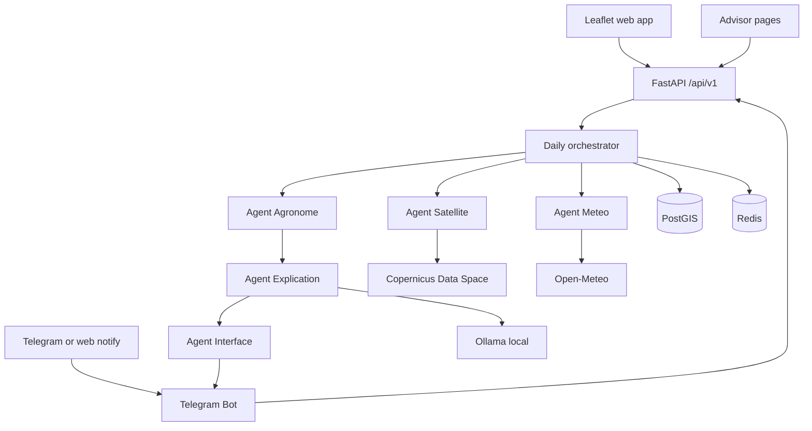
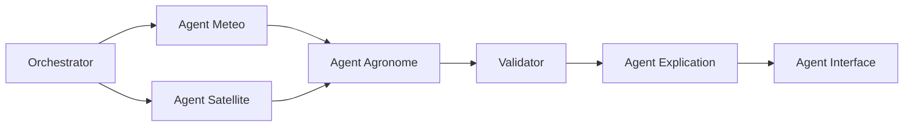
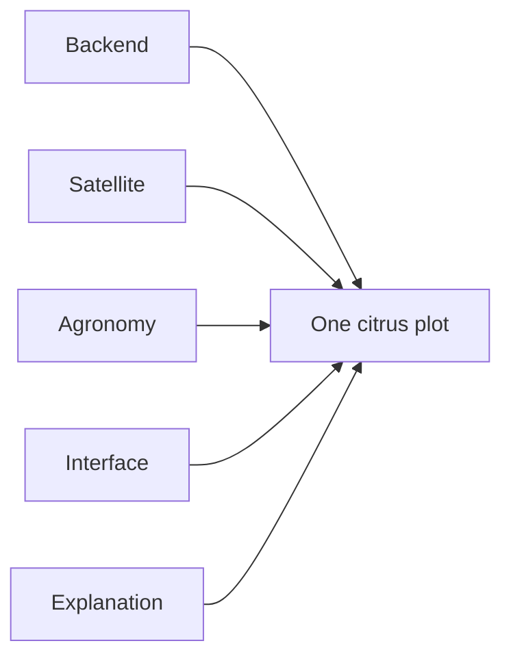

# Qatra

Documentation de soutenance, en français : [docs/Qatra-Documentation.pdf](docs/Qatra-Documentation.pdf).

Qatra is a precision-agriculture decision platform for citrus plots in Morocco.

A farmer draws a plot. Each day the system produces three outputs for that plot:

1. **Irrigation.** How much water the crop still needs, from a water-balance calculation.
2. **Canopy.** A Sentinel-2 reading (NDVI and NDWI), with the image date and a quality flag. If clouds hide the plot, a Sentinel-1 scene is recorded and confidence goes down.
3. **Spray window.** A weather-based disease-risk alert, a spray volume from the plot area, and a block when the wind is too strong.

The farmer reads this on a phone website and via Telegram or a web notification, as text and as a Darija voice note. An advisor sees the same plots on a dashboard: vigor, who to visit, and the season’s water total.

The language model explains numbers that code has already computed. It writes Darija, French, and Arabic. The dose, the index, and the spray rate stay in the agronomic code.

Five people build it, at the same level. Module M352, Advanced AI Engineering.

## Users

**Farmer.** Registers, draws a plot, enters the citrus stage, irrigation method, last watering, and an optional spray product. Reads today’s card. Asks a question on the site or on Telegram. Receives a message when the instruction changes, if they opted in.

**Advisor.** A cooperative or ORMVA adviser follows many plots: a vigor map, a visit list, and a season water total.

## Technologies

| Piece | Choice | Cost / note |
| --- | --- | --- |
| Mapping | Leaflet + OpenStreetMap | Free. Map display and plot boundary drawing. Replaces Mapbox. |
| Satellite imagery | Sentinel-1 / Sentinel-2 via Copernicus Data Space | Free under conditions. Google Earth Engine remains an option for eligible non-commercial research. |
| Conversational API | Ollama, open-source model run locally | No API fees. Depends on the machine’s hardware. |
| Speech | Piper or Web Speech API | Free locally. Test voice quality before choosing for Darija. |
| Notifications | Built-in web notifications, or a Telegram Bot | Free alternative to WhatsApp Cloud API, which can incur costs. |
| Web | Next.js, TypeScript, Leaflet | One site for the phone and the laptop. |
| API | Python, FastAPI | Orchestrator, water balance, validator, explanation. All routes live under `/api/v1`. |
| Database | PostgreSQL + PostGIS | Farmers, plot polygons, area, weather, satellite indices, recommendations. |
| Queue | Redis | The daily job. |
| Auth | JWT, bcrypt | Register and login. Farmer and advisor roles. Rate limit on the public auth routes. |
| Weather | Open-Meteo | Temperature, humidity, wind, rain, solar radiation. The basic forecast needs no key. |
| Evapotranspiration | FAO-56 Penman-Monteith | Reference evapotranspiration (ET0) from the weather inputs. |
| Crop water use | FAO-56 crop coefficient | `ETc = Kc × ET0`. Kc depends on the citrus stage. |
| Radar fallback | Sentinel-1 | Used when valid optical pixels are under 70 percent. NDVI stays empty. |
| Water productivity | FAO WaPOR | Later layer for evapotranspiration over Morocco. |
| Documents | FAO-56, INRA, public ministry bulletins | Pages the explanation can quote. They do not replace the formula. |
| Retrieval | Small FAO and INRA folder | Ask Qatra answers from the validated result plus those pages. |
| Containers | Docker Compose | API, PostGIS, and Redis on one command. |
| Tests and deploy | GitHub Actions | The daily-workflow test on every pull request. |
| Metrics | Prometheus and Grafana | API metrics at `/metrics`; Grafana at `http://localhost:3001`. Set `GRAFANA_ADMIN_PASSWORD` in `.env` before starting the stack. |

Deep learning is a later stress model, after field labels exist. The first dose is the reviewed water-balance engine. Sensors are out of this build.

## Architecture



One FastAPI service. The page and notifications both talk to that API. Redis queues the daily job. PostgreSQL with PostGIS stores farmers, polygons, weather, indices, and recommendations.

If Copernicus access is late, the satellite client reads one downloaded scene, and the live path says the image is missing. The rest of the pipeline still runs.

## Agents



**Orchestrator.** Loads the plot, sees which inputs exist, calls weather, satellite, and agronomy, then the validator and the explanation, and stores the row. Built by the Backend seat.

**Agent Météo.** Pulls temperature, humidity, wind, rain, and solar radiation from Open-Meteo, each with a timestamp. Built by the Agronomy seat.

**Agent Satellite.** Fetches Sentinel-2 for the polygon, masks clouds, computes NDVI and NDWI, and writes the scene date plus the valid-pixel share. When valid pixels are under 70 percent, it fetches a Sentinel-1 scene, sets `radar_fallback` to true, and leaves the optical index empty. It renders a PNG vigor overlay. A daily worker refreshes active plots. Built by the Satellite seat.

**Agent Agronome.** Computes ET0 with Penman-Monteith. Crop water use is `ETc = Kc × ET0`. The root-zone balance then applies useful rain, water already given, and drip or surface efficiency. The same agent raises `fungal_risk` from temperature, humidity, and rain, computes a spray volume from plot area and the rate per 100 L, and blocks that spray when wind is above 15 km/h. The rule and the factors are stored with the alert. Until an agronomist names the citrus disease, the label stays `fungal_risk`. Mildiou and oïdium are vine and vegetable diseases, so they are not the citrus labels. Built by the Agronomy seat.

**Validator.** Stands in front of anything the farmer can see. `show_dose` requires a known stage, a known irrigation method, ET0 newer than 48 hours, and a satellite scene no older than 10 days. Otherwise the status is `needs_check`. Spray text is withheld when the wind rule fails. The computed millimetres stay stored either way. Built by the Backend seat.

**Agent Explication.** Writes Darija, French, and Arabic from the validated JSON and a small FAO and INRA folder. Ask Qatra on the web and from Telegram uses that same JSON. Every number in the text already exists in the result. If the model is down, a template fills the three languages from the JSON fields. Built by the Explanation seat.

**Agent Interface.** Sends the Telegram text and, when Piper or Web Speech returns audio, a Darija voice note. The web card is the same text. Built by the Interface seat.

## Daily workflow


1. The worker loads each active plot.
2. Weather and satellite write their observations. Every value keeps its source, time, units, and quality. A missing image stays null.
3. Agronomy computes ET0, ETc, the deficit, the gross irrigation, the risk alert, and the spray decision.
4. The validator sets `show_dose` or `needs_check`, and allows or blocks the spray.
5. Explication writes the three texts. Interface adds the voice note.
6. The row is stored. The web card updates. A notification sends when the instruction changed and the farmer opted in. An inbound Telegram question uses the same Ask Qatra path.

`POST /plots/{id}/recommendation` runs the same pipeline for one plot, so a demo does not wait for midnight.

### Water balance

`ETc = Kc × ET0`

ETc and ET0 are millimetres per day. Kc comes from a citrus table in code. Each value has a source comment. `docs/assumptions.md` records the table, the effective-rain fraction, the drip and surface efficiency, the 10-day satellite rule, and the 15 km/h wind rule.

Root-zone update:

- Add irrigation already recorded.
- Add effective rain, a fraction of forecast rain. Soil, intensity, and timing decide that fraction. The whole forecast is not removed from today’s demand.
- Subtract ETc.
- Convert the net deficit to a gross amount with the efficiency of drip or surface irrigation.

Sample day, locked by a test: ET0 = 4.2 mm, Kc = 0.75, ETc = 3.15 mm.

Tests:

- That sample day equals 3.15 mm.
- The same inputs replay to the same output.
- Missing NDVI forces `needs_check`.
- A scene older than 10 days forces `needs_check`.
- Wind at 16 km/h sets `spray_blocked` to true.
- Units stay in millimetres. Wind stays in km/h.

A stress score sits beside the dose. Version one computes it from the NDVI change, the deficit, and the growth stage, and lists those factors in `reasons`.

### What the farmer does

1. Draws a polygon in Morocco and enters citrus, drip or surface, growth stage, last irrigation date, and a phone number if they want Telegram.
2. The orchestrator loads the profile.
3. Weather stores ET0 inputs, past rain, and forecast rain, with the request time.
4. Satellite stores NDVI, NDWI, scene date, and valid-pixel percent, or a missing flag with a reason.
5. The engine computes the balance and the spray decision.
6. The validator returns the status.
7. The explanation writes Darija, French, and Arabic.
8. The farmer sees the card and can ask a question. The advisor map updates from the stored row.

Example when the satellite scene is too old:

> Besoin à vérifier. La météo du jour est disponible. La dernière image satellite est trop ancienne. La dose précise n’est pas affichée tant que l’humidité du sol n’est pas confirmée.

## Shared contract

`docs/contract.json` is published on day 2. Everyone codes against this file. A field name changes only when the five agree.

```json
{
  "plot_id": "MA-001",
  "crop": "citrus",
  "stage": "fruit_growth",
  "area_ha": 1.2,
  "irrigation_method": "drip",
  "phone_opt_in": true,
  "date": "2026-10-15",
  "et0_mm_day": 4.2,
  "et0_open_meteo_mm_day": 4.1,
  "et0_source": "penman_monteith",
  "kc": 0.75,
  "etc_mm": 3.15,
  "rain_forecast_mm": 3.0,
  "effective_rain_mm": 1.5,
  "deficit_mm": 4.0,
  "gross_irrigation_mm": 4.7,
  "ndvi": 0.68,
  "ndwi": 0.2,
  "ndvi_observed_at": "2026-10-11",
  "valid_pixel_pct": 86,
  "radar_fallback": false,
  "wind_kmh": 9,
  "spray_blocked": false,
  "spray_volume_l": 240,
  "disease_risk": "low",
  "status": "show_dose",
  "reasons": ["fruit_growth", "rain_reduces_need"],
  "engine_version": "0.1.0",
  "text_fr": "",
  "text_ary": "",
  "text_ar": ""
}
```

`status` is `show_dose` or `needs_check`. `ndvi` is null when there is no usable optical scene. Every number in `text_fr`, `text_ary`, and `text_ar` already exists in the object.

## API and stored data

| Method | Path | Role |
| --- | --- | --- |
| POST | `/api/v1/auth/register` | Create an account, return a JWT |
| POST | `/api/v1/auth/login` | Return a JWT |
| POST | `/api/v1/plots` | Create a plot from a GeoJSON polygon |
| GET | `/api/v1/plots` | List the caller’s plots |
| POST | `/api/v1/plots/{id}/recommendation` | Run the pipeline and store one row |
| GET | `/api/v1/plots/{id}/recommendations` | Recommendation history |
| POST | `/api/v1/plots/{id}/ask` | Answer from the latest row |
| GET | `/api/v1/advisor/plots` | Linked plots: status, stage, deficit, satellite age, season total |
| POST | `/api/v1/telegram/webhook` | inbound Telegram events, routed to Ask Qatra |

Farmers read their own plots. Advisors read plots linked to them.

| Table | What it stores |
| --- | --- |
| `farmers` | Account, role, phone, notification opt-in |
| `plots` | Polygon, area, crop, stage, irrigation method, advisor link |
| `weather_observations` | Open-Meteo inputs, computed ET0, source, time |
| `satellite_observations` | NDVI, NDWI, scene date, valid-pixel share, radar flag, overlay path |
| `irrigation_events` | Dates and known volumes |
| `recommendations` | The contract JSON, engine version, input timestamps |
| `messages` | Recommendation id, language, text, audio path, send time |

A recommendation stores the engine version and the time of each input so the same inputs can be replayed.

## Screens and notifications

Farmer site:

- Map of Morocco and the farmer’s plots.
- Plot form: crop, stage, irrigation method, last watering, phone opt-in.
- Result card: status, reasons, ETc, forecast time, image time, spray decision, three languages.
- Vigor PNG on the card.
- Ask Qatra.

Advisor site:

- Map of followed plots colored by status.
- Visit list: sensitive stage first (flowering, fruit growth), then highest deficit, with the satellite age.
- Season balance: rain, water advised, estimated crop need.

Telegram / web notifications:

- Opt-in on the form.
- Outbound text is the validated explanation when the instruction changes.
- A Darija voice note is attached when synthesis returns audio. The text is always included.
- Inbound text is answered by Ask Qatra for that phone’s plot.

## Repository

How the team works in parallel: **[SEATS.md](SEATS.md)** · **[CONTRIBUTING.md](CONTRIBUTING.md)** · seat briefs in `docs/seats/`.

```text
qatra/
  SEATS.md
  CONTRIBUTING.md
  docker-compose.yml
  .env.example
  Makefile
  .github/workflows/ci.yml
  docs/
    contract.json          # shared JSON — change only via PR
    assumptions.md
    samples/ma001.geojson
    seats/{backend,satellite,agronomy,interface,explanation}.md
  backend/
    Dockerfile
    requirements.txt
    alembic/
    knowledge/{fao,inra}/
    app/main.py
    app/core/{config,database,security}.py
    app/api/v1/{auth,plots,recommendations,ask,advisor,telegram}.py
    app/domain/models/
    app/services/
      orchestrator.py      # Backend
      validator.py         # Backend
      weather_service.py   # Agronomy
      agronomy_service.py  # Agronomy
      satellite_service.py # Satellite
      explain.py           # Explanation
      notification.py      # Interface
    tests/test_engine.py   # ETc = 3.15 locked
  web/                     # Interface — Next.js + Leaflet + OSM
```

```bash
cp .env.example .env
docker compose up --build
# API  http://localhost:8000/docs
# Web  http://localhost:3000
```

`Makefile` shortcuts: `make up`, `make down`, `make api-test`, `make seed`.

## Seats

Five seats, same level. Seats can move in week 1. After that they stay fixed.



**Backend.** JWT and registration, PostGIS and migrations, Farmer, Plot, and Recommendation models, the REST API, roles, rate limiting, the orchestrator, the validator, and Docker Compose.

**Satellite.** Copernicus Data Space, NDVI and NDWI, cloud masking, Sentinel-1 fallback, PNG overlays, and the daily imagery fetch. Missing data stay null.

**Agronomy.** Open-Meteo, Penman-Monteith ET0, ETc and the root-zone balance, disease-risk rules, spray volume per plot, the 15 km/h wind block, and the engine tests.

**Interface.** Leaflet drawing, the farmer dashboard, the advisor pages, French, Darija, and Arabic in the UI, the Telegram webhook, and Darija speech via Piper or Web Speech.

**Explanation.** The explanation prompt, the FAO and INRA folder, Ask Qatra, the offline template, the integration test of the daily workflow, and the GitHub Actions workflow. Prometheus and Grafana come after that test is green.

How the five work:

- One repository. One branch per person. A teammate reviews each pull request.
- The JSON contract is published on day 2.
- A recommendation stores the engine version and the time of each input.
- Monday: 30 minutes. The group sets the week’s goal.
- Friday: each person demos on plot `MA-001`.
- A blocker older than one day is reported the same day.

The demo is done when one citrus plot in Morocco can be drawn on a phone, with live weather, a satellite date or an honest missing image, a dose or `needs_check`, a spray decision, an explanation in French and Darija, that same plot on the advisor map, and a Telegram message to one test phone.

## Six weeks

**Week 1 — contract.** Backend brings up Compose with PostGIS and Redis, the sample plot, and `docs/contract.json`. Satellite reads one Copernicus Data Space scene for that coordinate, or records why access is still pending. Agronomy returns ET0 from a fixed weather sample and passes ETc = 3.15. Interface shows a Leaflet map of Morocco. Explanation returns French and Darija for the fake JSON, with no extra numbers.

**Week 2 — accounts and live inputs.** Backend ships register, login, and plot create with a polygon. Agronomy stores Open-Meteo weather and the Penman-Monteith result in the contract fields. Satellite writes NDVI, NDWI, date, and valid-pixel share. Interface draws a polygon and posts it. Explanation explains a real agronomy JSON in three languages.

**Week 3 — one plot end to end.** Backend runs weather, satellite, agronomy, and the validator on `MA-001`. Validator cases: missing image, image older than 10 days, wind at 16 km/h. Interface shows the card with forecast time and image time as two facts. Satellite adds the PNG overlay.

**Week 4 — farmer product.** The farmer path works from the map to the card. Agronomy adds `fungal_risk` and the spray volume from area. Explanation ships Ask Qatra. Interface sends one Telegram text to a test number. Satellite survives a failed Copernicus Data Space call without crashing the API.

**Week 5 — advisor and notifications.** Advisor map, visit list, and season total. Daily worker over the demo plots. Darija voice note attached to the Telegram message. Sentinel-1 path when the optical scene is too cloudy. Inbound Telegram question answered by Ask Qatra.

**Week 6 — defense.** Farmer and advisor roles enforced. Integration test of the daily workflow in GitHub Actions. Prometheus and Grafana on the API and the worker. Full demo: a dose, a `needs_check`, a blocked spray, the advisor page, and Telegram text plus voice. Each person explains their module in two minutes. The result is a decision aid. The farmer still checks the soil before changing a real irrigation turn.

If Copernicus Data Space access is still closed in week 5, the daily job still runs on weather and the crop profile, the card says the image is missing, and the satellite function is shown on one downloaded scene.

## Done

- Compose starts the API, PostGIS, and Redis.
- A farmer can register, draw a citrus plot, and open a recommendation.
- Engine and validator tests pass: 3.15 mm, replay, missing satellite, old satellite, wind above 15 km/h.
- The card shows French, Darija, and Arabic, including from the offline template when the model is off.
- The advisor page lists the demo plots and a season total.
- A test phone receives the Telegram text and the Darija voice note, and a reply comes back through Ask Qatra.
