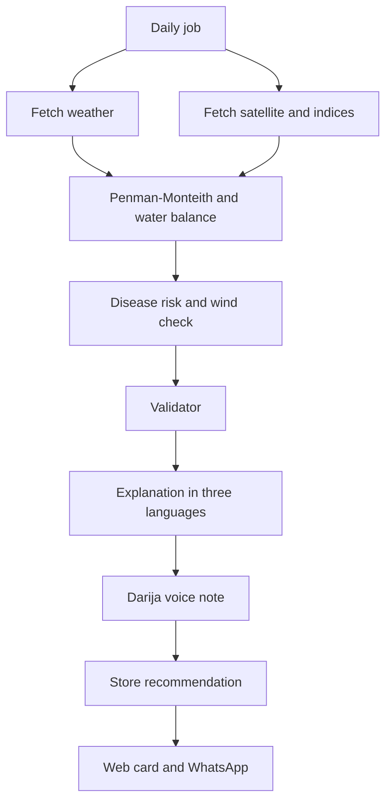

# Qatra

Precision irrigation for citrus plots in Morocco.

A farmer draws a plot. Each day Qatra estimates how much water the crop still needs, reads the canopy from satellite, and checks whether a spray is safe. The farmer sees the result on a phone website and on WhatsApp. An advisor sees the same plots on a map.

The water dose comes from an agronomic calculation. The language model explains that result in Darija, French, and Arabic. It does not invent the millimetres.

## Team

Five people, five seats, same level. Seats can move in week 1. After that they stay fixed.

| Seat | Builds |
| --- | --- |
| Backend | Accounts, PostGIS, the API, the orchestrator, the validator, Docker Compose |
| Satellite | Sentinel-2, NDVI and NDWI, cloud masking, Sentinel-1 fallback, vigor maps |
| Agronomy | Open-Meteo, Penman-Monteith ET0, the water balance, spray rules, engine tests |
| Interface | Mapbox drawing, farmer and advisor pages, WhatsApp, Darija voice |
| Explanation | Darija, French, and Arabic from the validated result, Ask Qatra, the daily test |

The orchestrator calls the other agents in order. The validator decides whether a precise dose is shown.

## What a day does

1. Weather stores temperature, humidity, wind, rain, and radiation.
2. Satellite stores NDVI, NDWI, the image date, and the share of valid pixels. A cloudy scene is marked missing. Sentinel-1 is a fallback, not a fake NDVI.
3. Agronomy computes reference evapotranspiration with FAO-56 Penman-Monteith, then crop water use: `ETc = Kc × ET0`. The sample day used in tests is ET0 = 4.2 mm and Kc = 0.75, so ETc = 3.15 mm.
4. The root-zone balance adds water already applied and the useful part of the rain, then applies drip or surface efficiency.
5. A spray volume is computed from the plot area. Wind above 15 km/h blocks the spray.
6. The validator returns `show_dose` or `needs_check`. A dose is shown when the stage and the irrigation method are known, the weather is under 48 hours old, and any satellite scene is at most 10 days old.
7. The explanation writes Darija, French, and Arabic from those numbers. WhatsApp sends that text when the instruction changes and the farmer opted in.

The full architecture, the JSON contract, the API, and the six-week plan are in [QATRA-REPORT.md](QATRA-REPORT.md).

## Stack

- Next.js and Mapbox for the farmer site and the advisor pages
- Python and FastAPI for the pipeline
- PostgreSQL with PostGIS, and Redis for the daily job
- Open-Meteo, Google Earth Engine, WhatsApp Cloud API
- One language model, called only by the explanation module

## How we work

- One repository, one branch per person, a teammate reviews each pull request.
- `docs/contract.json` is the shared result shape. It is published on day 2.
- Monday is a 30-minute goal check. Friday, each seat demos on plot `MA-001`.
- The demo is done when that citrus plot can be drawn on a phone, with live weather, a satellite date or an honest missing image, a dose or `needs_check`, an explanation in French and Darija, the same plot on the advisor map, and a WhatsApp message to one test phone.

## Six weeks

| Week | Goal |
| --- | --- |
| 1 | Compose up, one ET0 result, one satellite read, a Mapbox map, a bilingual explanation of a fake result |
| 2 | Register, login, draw a polygon, store live weather and NDVI |
| 3 | One full run on `MA-001`, including the validator and the vigor image |
| 4 | Farmer card, Ask Qatra, spray volume, one WhatsApp text |
| 5 | Advisor map, daily job, Darija voice note, answer an inbound WhatsApp question |
| 6 | Private plots, the integration test, and the full demo |
