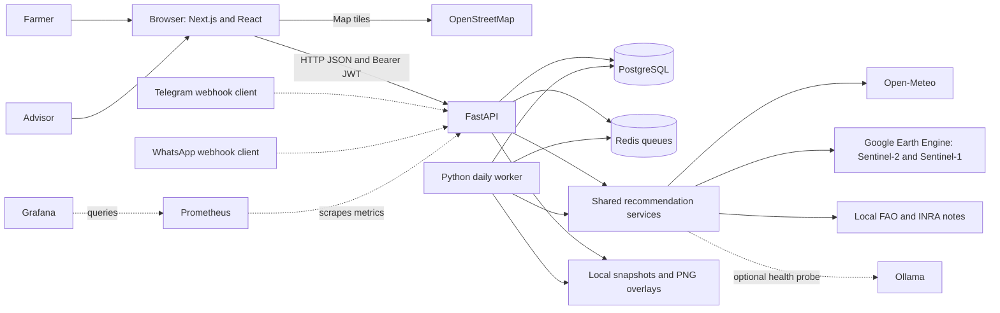
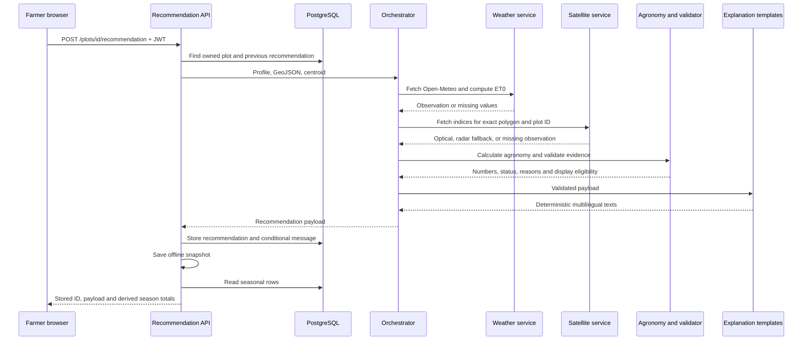
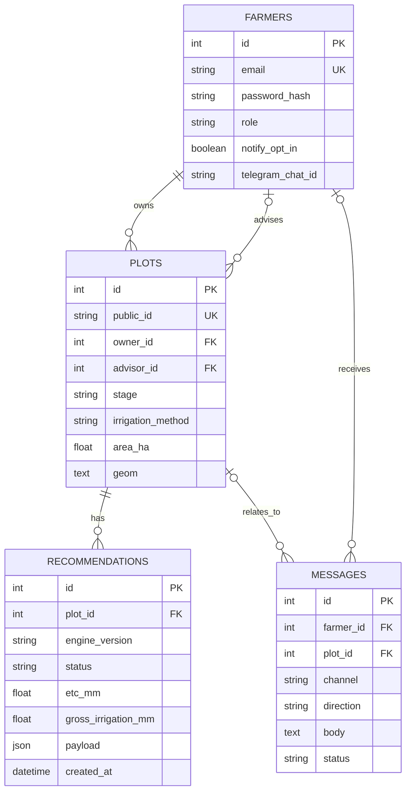
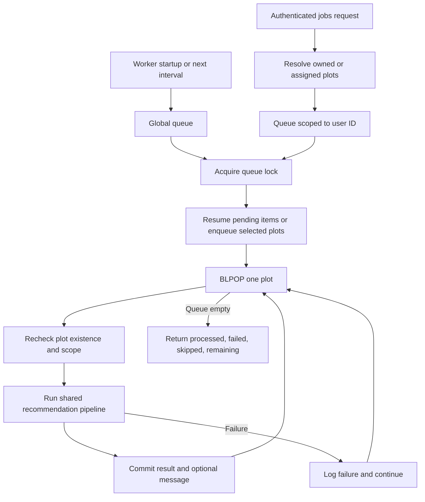
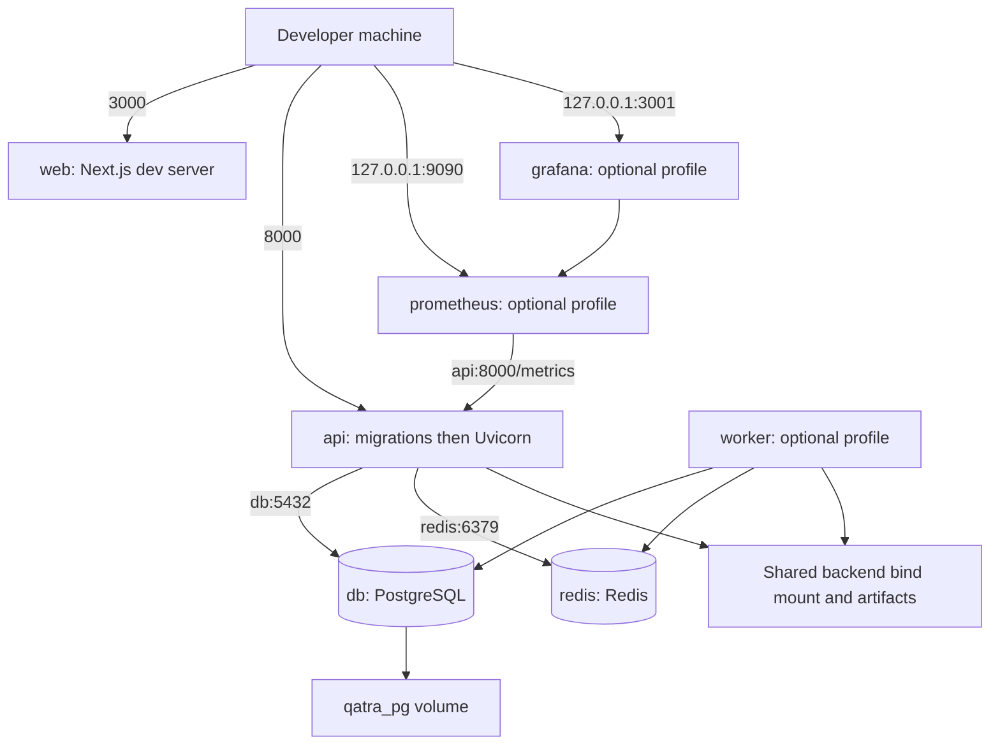

# Qatra — architecture of the integrated MVP

**Implementation snapshot: 5 November 2026. Branch: `mvp`.**

This document describes the code after integrating all developer branches. It distinguishes implemented behavior from optional configuration and future work. The older README describes a broader product vision; where it differs, the source files linked here define current behavior. Agricultural constants below describe software implementation, not independently validated field advice.

## 1. Purpose and users

Qatra is a decision-support application for citrus plots in Morocco. A farmer draws a plot, supplies its crop stage and irrigation method, and requests a recommendation. Weather and satellite observations feed a deterministic agronomy engine. A validator decides whether the calculated irrigation amount may be displayed. The application also shows fungal-risk indicators, spraying restrictions, explanations, and seasonal summaries.

| User | Implemented capabilities |
|---|---|
| Farmer | Register/login; create and view owned plots; request recommendations; view history; ask questions about a stored result; read notifications; assign an advisor through the API |
| Advisor | Register/login; view only assigned plots; inspect their status, outlines and seasonal totals; prioritize visits; trigger recommendations for assigned plots through the jobs API |
| Developer/operator | Run migrations and seed data; start the worker; configure external providers; inspect logs, metrics and tests |

There is no separate administrator role, hardware sensor ingestion, automatic irrigation actuator, or trained stress-prediction model in this MVP.

## 2. System context



The backend is a **modular monolith**, deployed as an API process and an optional worker process sharing Python service modules. Names such as “Agent Satellite” and “Agent Agronome” describe responsibilities; they are not independent autonomous agents or independently deployed microservices. Redis is a simple list queue, not Celery. PostgreSQL is the durable system of record.

## 3. Technologies and their exact roles

| Layer | Technology declared in repository | Role and current status |
|---|---|---|
| Web runtime | Node.js 20 Alpine | Next.js container and CI runtime |
| Web framework | Next.js `^15.1.0` | App Router, page routing, client components; verified build resolved 15.5.28 |
| UI | React / React DOM `^19.0.0`, TypeScript `^5.7.2` | Typed pages and shared components |
| Map | Leaflet `^1.9.4`, React Leaflet `^5.0.0`, OpenStreetMap tiles | Plot outlines, manual polygon drawing, satellite image overlays |
| Styling/icons | CSS in `globals.css`, Lucide React | Responsive interface, status indicators, icons; no Tailwind dependency |
| Speech | Browser Web Speech API | Reads visible French, Arabic or Darija text using available device voices |
| API runtime | Python 3.12 Slim | API and worker containers; CI uses Python 3.12 |
| HTTP API | FastAPI, Uvicorn, Pydantic | Routing, request validation, OpenAPI/Swagger and ASGI serving |
| Configuration | pydantic-settings | Environment variables and local `.env` settings |
| Persistence | SQLAlchemy, Psycopg binary, Alembic | ORM, PostgreSQL driver and versioned schema migrations |
| Database | PostgreSQL 16 Alpine | Four business tables plus Alembic version history |
| Optional geospatial DB | PostGIS 16-3.4 image; GeoAlchemy2 dependency | Extension can be installed, but current plot geometry remains TEXT containing GeoJSON |
| Geometry operations | Shapely | Polygon validity, bounds, geometry serialization and satellite processing |
| Queue | Redis 7 Alpine, redis-py | Global and per-user job queues, locks and queue status |
| Auth | python-jose, bcrypt | Signed JWTs and password hashes; passlib is installed but direct bcrypt calls are used |
| HTTP clients | HTTPX; urllib for overlay downloads | Weather, Ollama probe and Telegram requests; GEE thumbnail downloads |
| Weather | Open-Meteo | Temperature, rain, wind, humidity, solar radiation and optional provider ET0 |
| Satellite | Earth Engine Python SDK | Sentinel-2 optical data and Sentinel-1 fallback; requires external project authorization |
| Agronomy | Python calculations | FAO-56-inspired ET0, Kc, water balance, risk and seasonal arithmetic |
| Explanation | Deterministic Python templates and local Markdown references | French, Arabic, Darija and English output; no generated LLM advice in the active path |
| Optional model runtime | Ollama configuration | `/api/tags` health probe only; answers remain deterministic even if available |
| Notifications | PostgreSQL messages + frontend polling; optional Telegram Bot API | In-app inbox works without paid services; outbound Telegram text adapter exists |
| Packaging | Docker Compose, Dockerfiles, Makefile | Local reproducible service startup and common commands |
| Testing/CI | pytest, FastAPI TestClient, GitHub Actions, Next.js build | Backend regression tests, contract JSON parsing and frontend build/typecheck |
| Monitoring | Prometheus 2.55.1, Grafana 11.4.0, FastAPI instrumentator | Optional monitoring profile; API metrics at `/metrics` |

Sources: [web dependencies](../web/package.json), [backend dependencies](../backend/requirements.txt), [Compose](../docker-compose.yml). Python dependency specifications use minimum versions, not a lockfile. Frontend resolution is recorded in `package-lock.json`; exact installed versions should not be confused with version ranges.

## 4. Repository and responsibility boundaries

```text
web/src/
  app/                         Pages: login, farmer, advisor, ask, demo
  components/map/PlotMap.tsx    Leaflet map and image overlays
  components/farmer/            Plot form, result card, multilingual text
  components/ui/               Auth, role guard, top bar, notification bell
  lib/                         API client, session, types, labels, geometry
backend/
  app/main.py                  FastAPI composition, CORS, metrics
  app/api/v1/                  HTTP routes and ownership checks
  app/core/                    Settings, DB, auth, Redis, geometry helpers
  app/domain/models/           Farmer, Plot, Recommendation, Message
  app/services/                Weather, satellite, agronomy, validation,
                               orchestration, season totals, explanations,
                               notifications
  app/workers/                 Daily processing and demo seed
  alembic/versions/            Versioned migrations
  knowledge/{fao,inra}/        Local reference notes
  scripts/                    Satellite smoke utility
  tests/                      Regression and optional integration tests
  artifacts/                  Runtime snapshots and satellite PNGs (ignored)
docs/                         Contracts, seat briefs, assumptions, architecture
monitoring/                   Prometheus and Grafana configuration
.github/workflows/ci.yml       CI on mvp pushes and pull requests
```

| Seat | Main responsibility | Integrated Week 5 commit |
|---|---|---|
| Backend | Access, migrations, queue/worker, orchestrator, validator, Compose | `78eee10` |
| Agronomy | Weather, water calculations, explainable fungal factors, season totals/replay | `f12222c` |
| Explanation | Stored-state questions, deterministic multilingual replies, references | `1ab397a` |
| Interface | Map outlines, notifications, seasonal UI, text/speech controls | `a091ecf` |
| Satellite | Live GEE adapter, fallback quality, authorized PNG overlay endpoint | `1045804` |

The earlier explanation documentation/CI commits `165300b` and `59bb2e3`, and the `master` merge commit `ab8e217`, are also integrated. Merge resolutions preserve season totals and snapshot persistence in the recommendation route, and preserve notification refresh, GeoJSON outlines and satellite overlays in the farmer page.

## 5. Frontend architecture

| Route | Behavior |
|---|---|
| `/` and `/login` | Entry/authentication experience |
| `/farmer` | Owned plots, polygon drawing, create form, latest result, history and selected-plot satellite overlay |
| `/advisor` | Assigned plots, status map, visit ordering and seasonal metrics |
| `/ask` | Farmer selects an owned plot and asks about its latest persisted recommendation |
| `/demo` | Explicit demonstration view using sample data; separate from live provider results |

`SessionProvider` stores `{token, role, email}` in browser `localStorage` under `qatra.session`. `RequireRole` controls the page experience; the API separately enforces access. The shared API client reads `NEXT_PUBLIC_API_URL`, appends `/api/v1`, sends `Authorization: Bearer ...`, and turns failed responses into `ApiError`.

The Leaflet map is dynamically loaded with server rendering disabled. Drawn rings use longitude/latitude GeoJSON coordinates; Leaflet overlay bounds use latitude/longitude pairs. Plot geometry from the API is authoritative, with locally saved rings as a fallback. The UI extracts an outer ring for display; complete MultiPolygon editing is not implemented.

Satellite PNGs are fetched with a JWT, converted to browser object URLs, displayed using bounds returned in response headers, and revoked when no longer used. CORS exposes `X-Qatra-Overlay-Bounds` and `X-Qatra-Overlay-Observed-At`.

The notification bell polls every 30 seconds, refreshes on the local `qatra:notifications` event, and tracks a seen-message ID in local storage. This is an in-app inbox, not browser push or WebSockets. Speech synthesis is optional and device-dependent; text remains visible. Latin-script Darija uses an available French voice, while Arabic script prefers Arabic voices. There is no server-generated voice-note attachment path yet.

Advisor visit ordering puts sensitive stages first, then sorts by gross irrigation need. The UI sums displayed millimetres and cubic metres; the millimetre sum is not an area-weighted cooperative water balance. Cubic metres are the meaningful additive volume across plots.

## 6. Recommendation pipeline



The current orchestrator awaits weather and satellite sequentially. It does not concurrently fan out provider requests. The daily worker calls the same orchestrator but has its own persistence wrapper. Manual and worker paths notify only when the farmer opted in and the status changed; a changed amount with unchanged status does not currently generate a new notification.

Source: [orchestrator](../backend/app/services/orchestrator.py), [recommendation routes](../backend/app/api/v1/recommendations.py), [worker](../backend/app/workers/daily.py).

### Weather

Open-Meteo supplies daily minimum/maximum temperature, precipitation, shortwave radiation and ET0, hourly humidity/wind, and current temperature/humidity/wind. The service computes FAO-56 Penman–Monteith ET0 when its required inputs exist; otherwise it can use Open-Meteo's ET0. If neither is available, ET0 is null. Provider times are converted to UTC using the reported offset. Network/schema failures produce missing observations rather than sample weather. The HTTP timeout is eight seconds.

### Satellite

The live implementation uses GEE, not a direct Copernicus Data Space client. It queries `COPERNICUS/S2_SR_HARMONIZED`, defaults to a ten-day window, selects a low-cloud scene, masks SCL classes 0/1/2/3/8/9/10/11, and computes polygon mean indices:

```text
NDVI     = (B8 - B4) / (B8 + B4)
NDWI_GAO = (B8 - B11) / (B8 + B11)
```

Reflectance is divided by 10,000 before the ratios. The code estimates valid-pixel percentage and expects at least 70%. When optical data is unusable, it queries `COPERNICUS/S1_GRD`. A radar scene provides provenance and reduced confidence, not synthetic NDVI/NDWI. Missing credentials, scenes or provider access remain missing. Explicit offline manifests and injected scene clients support tests.

NDVI overlays are clipped PNG thumbnails. Names incorporate a sanitized plot identifier, geometry digest, observation date and scene digest; writes use a temporary file and atomic replacement. The protected overlay endpoint uses stored plot metadata and a fixed artifact directory, not a client-supplied filesystem path. Unavailable overlays return 404. Some detailed radar/quality fields exist in the internal observation but are not included by `to_contract_dict()`; the saved payload includes the core indices, source and `satellite_quality`.

### Agronomy and validation

These are versioned software assumptions; review them with the Agronomy seat before changing field guidance.

| Calculation/rule | Current implementation |
|---|---|
| Crop need | `ETc = Kc × ET0`, mm/day |
| Kc | initial 0.70; flowering 0.75; fruit_growth 0.75; maturity 0.70; dormant 0.65 |
| Daily net irrigation | `max(ETc - useful_rain - irrigation_already_applied, 0)` |
| Gross irrigation | Net divided by efficiency: drip 0.90, surface 0.70 |
| Useful rain | Non-negative daily rain; capped by root-zone room only when that optional mode is supplied; no fixed 50% rain fraction |
| Optional root-zone engine | TAW, RAW, depletion and percolation functions exist; ordinary orchestration does not supply soil history |
| Spray block | Wind **at or above 15 km/h**, or unknown wind |
| Fungal factors | Humidity ≥80%, temperature 15–28°C, rain ≥2 mm |
| Risk level | Three factors: high; two: medium; zero/one: low; missing humidity/temperature: unknown |
| Display gate | Known stage/method, finite non-negative ET0, weather age ≤48h, finite NDVI in [-1,1], optical date age ≤10 days, valid pixels in [70,100] |
| Invalid dates | Missing/unparseable/future dates prevent dose display |

The validator produces `show_dose` or `needs_check`. `display_dose` is null when validation blocks display, while computed values remain stored for traceability. The engine calculates spray volume, but the orchestrator does not currently publish that field. `last_irrigation_on` is stored on a plot but actual irrigation volumes/history are not wired into the standard orchestration path.

### Seasonal arithmetic

The agricultural season starts on 1 September. `season_totals()` counts the latest recommendation per day, avoiding double counting repeated calculations. It sums known ETc, recorded useful rain and doses that were actually eligible for display. `needs_check` days contribute zero advised water. Empty seasons return null totals; missing ETc days have a counter. Volume conversion is `mm × hectares × 10 = m³`.

The manual recommendation response attaches a derived `season` object after storage. It does not mutate historical payloads with newly computed season totals. Advisor responses expose flat season fields. The historical recommendation endpoint returns stored payloads, so a reloaded farmer card is not guaranteed to contain the transient season object from the original POST response. Season values measure recorded advice, not actual water delivered or measured consumption.

## 7. Database architecture



| Table | Additional details |
|---|---|
| `farmers` | Also stores full name, optional phone and creation time. Both farmer and advisor accounts share this table. Email has a unique index. |
| `plots` | Also stores crop, optional last irrigation date and creation time. `advisor_id` is nullable and indexed. Geometry is GeoJSON text, not a PostGIS Geometry column. |
| `recommendations` | Plot FK is indexed. Payload is SQLAlchemy JSON, alongside selected scalar columns for queries. Provider timestamps and texts are inside payload. |
| `messages` | Farmer and plot FKs are nullable. Test notifications need no plot. Creation time is recorded; no server-side read/unread field exists. |

Migrations:

1. `0001_initial`: four business tables and indexes.
2. `0002_plot_advisor`: advisor FK and index.
3. `0003_required_fields`: required-column constraints aligned with ORM declarations.

No separate weather-observation, satellite-observation, irrigation-event, season-total or chat-history tables currently exist. Raw provider responses and all internal observation details are not persisted, so full provider replay is less complete than agronomy input replay.

See [models](../backend/app/domain/models/) and [migration directory](../backend/alembic/versions/). For legacy database adoption and backups, see [backend setup notes](backend-week-5.md); do not blindly stamp migration history over an unknown schema.

## 8. API catalog

All paths below use `/api/v1` except the explicit root/metrics/docs entries. JWT routes return 401 for missing/invalid authentication; scoped plot lookups generally return 404 for inaccessible plots.

| Method | Path | Access / purpose |
|---|---|---|
| GET | `/health` | Public process-health response; not a DB/Redis readiness test |
| POST | `/auth/register` | Public; accepts farmer/advisor role; rate limited |
| POST | `/auth/login` | Public; issues Bearer JWT; rate limited |
| POST | `/plots` | Authenticated; creates plot owned by caller, requiring valid polygon and positive area |
| GET | `/plots` | Caller's owned plots |
| GET | `/plots/{public_id}` | Owned plot details |
| PUT | `/plots/{public_id}/advisor` | Owner assigns existing advisor or null |
| POST | `/plots/{public_id}/recommendation` | Owner; synchronous calculation and persisted result |
| GET | `/plots/{public_id}/recommendations` | Owner; stored history, newest first |
| GET | `/plots/{public_id}/satellite-overlay` | Owner or assigned advisor; PNG with bounds headers |
| POST | `/plots/{public_id}/ask` | Owner; question plus optional en/fr/ar language; answers from latest stored row |
| GET | `/advisor/plots` | Advisor; assigned plots, latest status and seasonal totals |
| POST | `/jobs/daily` | Authenticated; enqueues/drains owned or assigned plots only |
| GET | `/jobs/daily/status` | Caller's queue length |
| GET | `/notifications` | Caller's latest 30 outbound messages |
| POST | `/notifications/test` | Caller's test message through configured notification channel |
| POST | `/telegram/webhook` | Optional shared-secret check; prototype question handler |
| GET | `/whatsapp/webhook` | Provider verification challenge with verify token |
| POST | `/whatsapp/webhook` | HMAC-SHA256 signature required; prototype question handler |
| GET | `/` | API name and links, outside v1 |
| GET | `/docs`, `/openapi.json` | Generated API documentation, outside v1 |
| GET | `/metrics` | Prometheus API instrumentation, outside v1 |

The example [contract JSON](contract.json) is a shared example, not a formal JSON Schema. CI checks that it parses, not that every API payload conforms. Actual payloads contain extra fields such as `display_dose`, observation quality/timestamps and coordinates of the weather lookup. The new advisor-assignment endpoint is API-only; no dedicated assignment screen exists.

## 9. Authentication and trust boundaries

- Passwords use bcrypt. JWTs use configurable signing settings, default HS256, and a default seven-day lifetime. The API reloads the account from PostgreSQL for each authenticated request.
- Role authorization is enforced server-side. Advisor access requires `plot.advisor_id == user.id`; farmer ownership uses `plot.owner_id == user.id`.
- Registration permits choosing either supported role; it is not an administrator approval workflow. Becoming an advisor does not grant access to unassigned plots.
- Authentication endpoints use a per-process IP counter: 20 attempts per 60 seconds. It is not a shared Redis limiter across API replicas.
- Browser tokens are stored in localStorage, not HttpOnly cookies. There is no refresh-token, password-reset, email-verification or logout-revocation service.
- CORS is configurable, defaulting to localhost:3000. The development Compose setup exposes database and Redis ports as well as API/web ports.
- The overlay endpoint validates access before serving files. Clients cannot choose arbitrary artifact paths.
- `.env`, credentials, local runtime artifacts and DB backups must remain untracked. GEE credentials are mounted read-only using the optional override example.

## 10. Explanation and messaging

The active `explain.py` uses deterministic templates. It probes Ollama but does not request generated prose. `ask_qatra()` detects or accepts language, categorizes the question, builds an answer from known stored values, and selects up to two matching paragraphs from local FAO/INRA notes. This is keyword-based retrieval over Markdown, not embeddings, a vector database, or live source retrieval.

The web Ask route passes the authorized recommendation payload directly to the answer function. It also writes a snapshot for the prototype offline channel path. Runtime snapshots now default to `backend/artifacts/last_stored_state.json`, keeping dynamic data outside committed source files.

**Messaging limitation:** the Telegram and WhatsApp handlers still use a global latest snapshot, without mapping the sender to an authorized farmer/plot. They return answers in the webhook HTTP response; they do not implement a complete outbound conversational reply workflow. This is suitable only as an explicitly controlled prototype, not multi-user messaging. The independent Telegram text-sending adapter exists, but regular recommendation and daily-worker wrappers currently select the web notification channel.

The local notes contain project-maintained reference excerpts. Their presence should not be described as complete ingestion of authoritative FAO or INRA publications. The unused `services/explanation.py` and mock data are legacy/demo code; the live routes call `services/explain.py`.

## 11. Background processing and reliability



Queue names are `qatra:daily:queue` and `qatra:daily:queue:user:{id}`. Each uses a Redis lock with a one-hour timeout. `--loop` runs a pass at startup, then waits 86,400 seconds; `--interval` changes that delay, and `--sleep` controls retry delay after a whole-pass failure. This is not a cron schedule aligned to midnight.

Per-plot failures do not stop later plots. Missing/deauthorized plots are skipped. Failed popped items return to consideration on a future pass, not through an immediate retry queue. Redis has no durable volume in Compose. A process crash after BLPOP can lose an item until a later full pass. Global, user and manual runs can duplicate a plot calculation; the seasonal reducer limits double counting, but there is no exactly-once job guarantee or cross-queue per-plot lock. The API jobs call waits for processing; it is not a background task ID/polling protocol.

## 12. Deployment and configuration



| Service | Host port | Startup / persistence |
|---|---|---|
| web | 3000 | `npm run dev`; source bind mount, separate node_modules/.next volumes |
| api | 8000 | `alembic upgrade head` then Uvicorn with reload; backend/docs mounts |
| db | 5432 | PostgreSQL healthcheck; `qatra_pg` volume |
| redis | 6379 | PING healthcheck; no durable Redis volume |
| worker | None | `worker` profile; waits for healthy API/DB/Redis; same backend source mount |
| prometheus | 127.0.0.1:9090 | `monitoring` profile; scrapes API every 15 seconds; volume |
| grafana | 127.0.0.1:3001 | `monitoring` profile; provisioned datasource/dashboard; volume |

The base Compose configuration is for development: hot reload, bind mounts, default development credentials, and no HTTPS/reverse proxy. A production deployment requires its own configuration. Worker artifacts and API artifacts share the same local directory only because both services mount `backend/`.

| Setting | Purpose |
|---|---|
| `DATABASE_URL`, `REDIS_URL` | SQL and queue connections; Compose overrides hostnames to service names |
| `JWT_SECRET`, `JWT_ALGORITHM`, `ACCESS_TOKEN_EXPIRE_MINUTES` | JWT signing and expiry |
| `CORS_ORIGINS` | Comma-separated browser origins |
| `NEXT_PUBLIC_API_URL` | Browser-visible API address; localhost works only on the machine running the browser |
| `OPEN_METEO_BASE_URL` | Weather endpoint |
| `GEE_PROJECT_ID`, `GEE_CREDENTIALS_PATH` | Earth Engine project/credentials configuration |
| `GEE_EARTHENGINE_CREDENTIALS_DIR` | Used by the optional Compose override to mount existing EE credentials |
| `SATELLITE_OVERLAY_DIR` | Local PNG artifact directory |
| `KNOWLEDGE_DIR`, `LAST_STORED_STATE_PATH` | Markdown reference directory and runtime snapshot |
| `OLLAMA_BASE_URL`, `OLLAMA_MODEL` | Optional model-runtime settings; active path only probes health |
| `TELEGRAM_BOT_TOKEN`, `TELEGRAM_WEBHOOK_SECRET` | Optional Telegram configuration |
| `WHATSAPP_VERIFY_TOKEN`, `WHATSAPP_APP_SECRET` | Optional webhook verification/signature checks |
| `NOTIFICATION_CHANNEL`, `SPEECH_BACKEND` | Channel default and speech setting; current browser speech is implemented in the UI |
| `POSTGRES_IMAGE`, `GRAFANA_ADMIN_PASSWORD` | Optional DB image and monitoring login configuration |

`SATELLITE_DEMO_FALLBACK` remains a legacy setting but does not inject sample imagery into the live orchestrator. Copernicus client settings remain declared without a direct live CDSE adapter. Ollama, Telegram, WhatsApp and GEE are not separately provisioned by base Compose.

### Run locally

```sh
# Create .env from .env.example only when .env does not already exist.
docker compose up --build -d
docker compose exec api python -m app.workers.seed_ma001
docker compose --profile worker up --build -d worker
docker compose ps
```

Open [web login](http://localhost:3000/login) or [API docs](http://localhost:8000/docs). Demo accounts are `farmer@example.com` and `advisor@example.com`, both using `demo-demo`. The seed links MA-001 to the demo advisor. It is repeatable and refuses to take that plot from another owner.

For optional live imagery, inspect [the GEE override example](../docker-compose.gee.example.yml) and [satellite notes](satellite-earth-engine.md). Do not copy credential contents into the repository. For monitoring, configure credentials and use `docker compose --profile monitoring up -d prometheus grafana`.

Useful commands:

```sh
docker compose logs --tail 100 api worker
docker compose exec api alembic current
docker compose exec api python -m app.workers.daily --once
docker compose exec api python -m pytest -q
docker run --rm qatra-web npm run build
docker compose down
```

`down` preserves named database volumes; adding `-v` would delete them and is not part of routine shutdown. The independent frontend build above avoids corrupting a running development server's `.next` directory.

## 13. Verification and CI

CI runs on pushes to `mvp` and on pull requests. Its three jobs install and run backend pytest, parse `docs/contract.json`, and build/typecheck the frontend. The PostgreSQL/Redis integration test is opt-in and is skipped by the default suite; regular HTTP tests use SQLite and service seams where appropriate.

Observed during integration on 5 November 2026:

- All developer branches merged with their original commit ancestry preserved.
- Backend: **130 passed, one opt-in integration test skipped** in the default Docker run.
- The opt-in PostgreSQL/Redis migration, repeatable seed, recommendation-persistence and downgrade/upgrade test was then run separately against disposable containers and passed.
- Frontend: optimized Next.js production build and typecheck passed.
- Live demo: both roles authenticated; MA-001 recommendation persisted; Ask Qatra referenced that stored recommendation; advisor saw the assigned plot and season fields; notification listing returned successfully.
- Provider behavior: Open-Meteo returned live weather; Earth Engine authentication failed in the current container environment, producing missing imagery, `needs_check` and null NDVI. The project setting is present, but live imagery authorization is not verified.
- The running worker completed a real pass: one plot enqueued, one processed, zero failures and an empty queue.

Test groups cover agronomy/replay/season arithmetic, validator boundaries, geometry, satellite adapters and overlay authorization, owner/advisor isolation, notifications, multilingual explanations, webhooks, daily processing and failures. The optional `test_backend_integration.py` requires an empty disposable PostgreSQL database and Redis; it upgrades migrations, seeds twice, stores a recommendation, downgrades and upgrades again.

## 14. Current limits and next design decisions

| Area | Current limitation / implication |
|---|---|
| Live satellite availability | Adapter is implemented; real access depends on GEE credentials/project and usable scenes. Missing imagery blocks a displayed dose. |
| Channel identity | Telegram/WhatsApp use one global snapshot. Add sender-to-account/plot authorization before multi-user messaging. |
| Recommendation storage | Snapshot writing happens after the SQL commit; a filesystem failure can report an error after the row was already saved. |
| Scheduling | No durable acknowledged queue, dead-letter queue, exactly-once guarantee or distributed calendar scheduler. |
| Input history | Soil depletion and actual irrigation-event storage are not connected to ordinary recommendations. |
| Validation completeness | The display validator does not itself require rainfall; missing rain may leave gross dose null even with otherwise valid inputs. Review this boundary with Agronomy. |
| Season completeness | Missing days are not inferred; missing rain in recorded rows contributes zero. Totals are recorded advice, not measured consumption or guaranteed savings. |
| Satellite quality | Pixel-validity calculation and cloud thresholds require field/data validation. Internal provenance is richer than the persisted contract. |
| Contract governance | Example JSON lacks schema enforcement; replay/version compatibility is not a complete API versioning policy. |
| Security/deployment | Development credentials, self-selected advisor role, localStorage tokens and public local service ports need production treatment. |
| Scale | Synchronous SQL and some provider operations occur inside async request paths; advisor/history queries are not paginated or bulk-optimized. |
| Notifications | Regular runs select web; inbox polls rather than pushes; seen state is browser-local and not scoped by account key. |
| Speech/AI | Browser speech only; no Piper service, server voice-note delivery, vector database, generated conversational model, or trained stress detector. |
| Metrics | API request metrics are wired; dedicated worker/business metrics and alerting are not. |
| Tests | No browser end-to-end suite or automatically provisioned live-provider test environment in CI. |

These are explicit implementation boundaries, not claims that the corresponding roadmap items are complete. They provide a concrete starting point for the next requested modifications.
